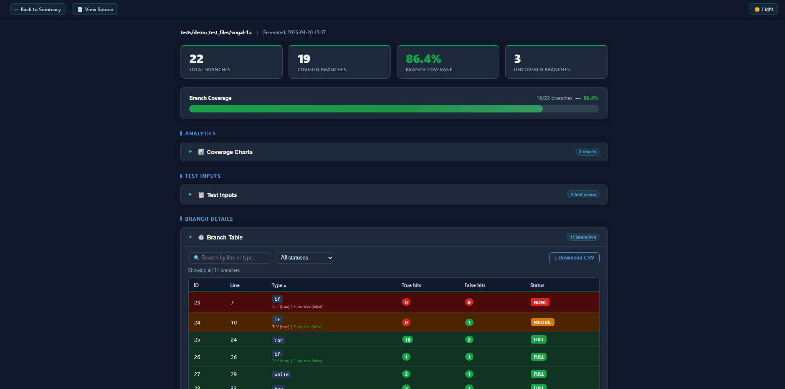
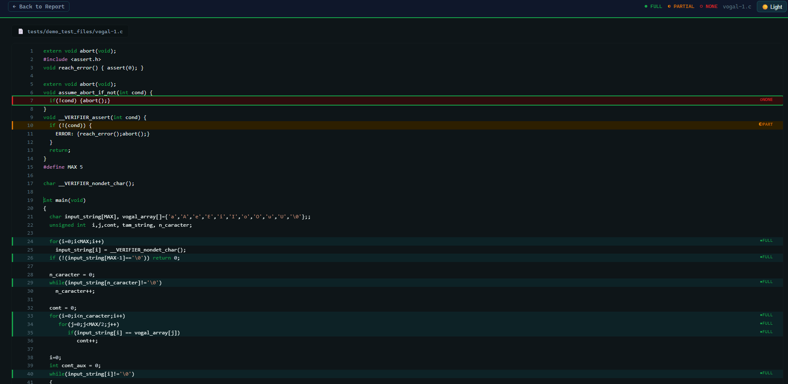
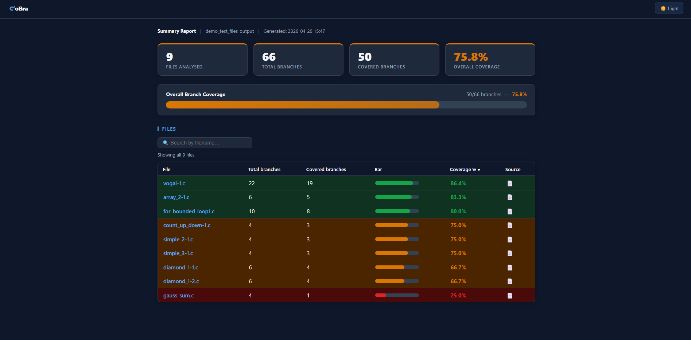

# C²oBra — C Coverage Branch Testing

[](https://glebtut.github.io/c2obra)
[](https://github.com/GlebTut/c2obra/actions)
[](LICENSE)
[](#screenshots)

<p align="center">
  
</p>

A source-level **branch coverage instrumentation tool** for C programs.
C²oBra automatically instruments C source files to track which branches are executed during testing,
then reports coverage results as interactive HTML/CSV reports with VS Code-style source view,
a summary dashboard, and full CI/CD integration via GitHub Actions.

📖 **[User Resources](https://glebtut.github.io/c2obra/user_resources.html)** — full installation guide, usage docs, and FAQ  
🔍 **[Coverage Viewer](https://glebtut.github.io/c2obra/covcheck.html)** — drag-and-drop `coverage_report.json` inspector  
📊 **[Live Reports](https://glebtut.github.io/c2obra)** — auto-published coverage reports on every push to `main`

---

## How It Works

1. **Scan** — `src/clang_scan.py` parses the file with libclang, using the same `-D`/`-I` flags as gcc, and decides which decisions exist (`if`, `while`, `for`, `do-while`, `switch`, ternary). It skips decisions outside a function body, decisions produced by a macro expansion and a `switch` with no labels, and prints how many it skipped.
2. **Instrument** — `src/instrument.py` uses Tree-sitter only to find the text range to rewrite. It pairs each Clang decision with a Tree-sitter node by (kind, line, column) and wraps the condition in a `cover()` call; a decision with no matching node stops instrumentation with a pairing error. For a header containing a GNU statement expression `({ ... })`, the condition range can come from Clang instead.
3. **Compile & Run** — the instrumented file is compiled with `src/cov_runtime.c` and executed against Sikraken-generated test inputs; each run is classified as `pass`, `partial`, `timeout`, or `crash`
4. **Report** — branch coverage is calculated per branch edge (true/false) and output as JSON + interactive HTML/CSV with annotated source view
5. **Summary** — `src/merge_reports.py` aggregates all per-file results into a single `summary_report.html` dashboard
6. **Deploy** — GitHub Actions automatically instruments, compiles, tests, and publishes reports to GitHub Pages on every push to `main`

---

## Requirements

- Python 3.10+
- GCC
- gcc-multilib (for 32-bit compilation support used by Sikraken)
- python3-venv
- Clang 18 (`clang-18`): the scan passes its builtin header folder (`clang -print-resource-dir`) to libclang. `src/clang_scan.py` runs `clang` unless `C2OBRA_CLANG` names another binary, e.g. `export C2OBRA_CLANG=clang-18`
- tree-sitter, tree-sitter-c, libclang (pinned in `requirements.txt`)

---

## Setup

Clone [github.com/GlebTut/c2obra](https://github.com/GlebTut/c2obra), then run from the repo folder:

```bash
bash install.sh
```

It installs the system packages (`python3.12-venv`, `gcc-multilib`, `wget`, `unzip`, `clang-18`),
creates `venv/` with the pinned Python packages, and downloads Sikraken to `~/sikraken/`.

### Manual setup (if install.sh fails)

```bash
sudo apt install python3.12-venv gcc-multilib clang-18
python3 -m venv venv
source venv/bin/activate
pip install -r requirements.txt
```

Sikraken is then not installed; see the Sikraken section below.

`scripts/smoke_test.sh` checks the install.

Developer tools (smoke test, timing, batch runs) are in `scripts/`; see
[scripts/README.md](scripts/README.md). They are not needed to use the tool.

---

## Usage

### Run the full pipeline on a single file

```bash
bash c2obra.sh path/to/file.c
```

The pipeline runs these steps automatically:

1. **Auto-detects** if the file uses `__VERIFIER_nondet_*` inputs
2. **Step 0** *(input-driven files only)* — runs Sikraken with a 10s budget to generate a test suite XML
3. **Step 1** — instruments the C file via `src/instrument.py`
4. **Step 2** — compiles the instrumented file with `gcc` + `cov_runtime.c` + `verifier_stubs.c`
5. **Step 3** — runs all test cases via `src/run_tests.py` (parallel execution); classifies each run as `pass`, `partial`, `timeout`, or `crash`
6. **Step 4** — generates interactive HTML/CSV coverage report via `src/report.py`

**Example output:**
```
=== Detected: input-driven file ===
=== Step 0: Run Sikraken ===
✓ Sikraken done → ~/sikraken/sikraken_output/benchmark01_conjunctive/test-suite
=== Step 1: Instrument ===
=== Step 2: Compile ===
=== Step 3: Run Tests ===
=== Step 4: Report ===
✓ Wrote report to output/benchmark01_inst_report.html
```

> **Note:** Sikraken must be installed at `~/sikraken/` — see the Sikraken section below.

Environment variables (single-file mode; unset = the behaviour above): `DATA_MODEL`
(`ILP32`/`LP64`, passed to the Clang scan, gcc and Sikraken), `OUT_DIR` (all outputs and the
binary go there), `SIKRAKEN_SUITE` (use this test suite, or `-` for none, and do not run
Sikraken), `LDLIBS` (e.g. `-lm`), `CFLAGS`, `SIKRAKEN_DIR`. See the `--help` output of `c2obra.sh`.

### Directory mode

`path/to/file.c` can also be a directory. Every `.c` file in it, including subfolders, is
instrumented with globally unique branch IDs; each `.c` file directly in the directory is then
built and run as its own binary, and a summary report is written to `output/summary_report.html`.

### Inspect a report locally (no server needed)

Open `covcheck.html` in your browser and drag-and-drop any `coverage_report.json` file to view:
- KPI cards (total branches, full/partial/none counts, test run count)
- Segmented coverage progress bar (green = fully covered, amber = partial, grey = not covered)
- Filterable branch table with status badges
- Test run list with inputs, status, and pass/fail/timeout/crash classification
- Multi-file comparison mode when multiple JSON files are loaded simultaneously

---

## Branch coverage definition

C²oBra counts **edges**: each outcome of a decision (the true or false side of a condition, a
`switch` label, the implicit default of a `switch`) is one edge, and coverage is the share of
edges hit by the test runs. Edges that can never be taken are still counted. The definition is written down as one
small program per construct with its expected edges in
[`tests/definition/expected.csv`](tests/definition/expected.csv), checked by
`unittests/test_definition.py`; the counting rules are in [Coverage Model](#coverage-model) below.

**Known limitations:** see [docs/architecture.md](docs/architecture.md#known-limitations).

---

## Coverage Model

C²oBra uses an **edge-based branch coverage model**:

```
coverage % = edges hit / edges that exist × 100
```

This is not gcov's model. gcov counts each operand of `&&` and `||` as its own branch
(`if (a > 0 && b > 0)` gives 4 branches with GCC 13.3 at `-O0`), while C²oBra counts the whole
decision as 2 edges, so the two differ on compound conditions.

The edges that exist are listed in the branch map (`"edges"` in `<file>_branch_map.json`);
`src/edges.py` turns the map and the hit counts into covered/total for every report.

| Construct | Edges |
|-----------|-------|
| `if`, `while`, `do-while`, `for`, ternary `?:` | **2**: true and false |
| `for(;;)` (no condition) | **2**, like `while(1)`; the false edge can never be taken |
| `switch` `case` / `default` label | **1** per label: the label is taken |
| `switch` without `default` | **1** extra edge: the implicit default (no label matched) |

For example, a single `if` statement at line 10 = 2 edges:
- `if` at line 10 — true edge (condition holds)
- `if` at line 10 — false edge (condition does not hold)

`tests/definition/` holds one small program per construct with hand-derived expected edges
(`expected.csv`); `unittests/test_definition.py` checks them.

> Before 2026-10-20 every entry, including each `switch` label, counted 2 edges and `for(;;)`
> counted none.

### Run Status Classification

Each test run is classified based on exit condition and whether branch data was saved:

| Status    | Condition                                      |
|-----------|------------------------------------------------|
| `pass`    | Clean exit (code 0 or non-zero with branches)  |
| `partial` | Timeout or crash — but branch data was saved   |
| `timeout` | Timed out with no branch data saved            |
| `crash`   | Signal kill (SIGSEGV/SIGABRT/SIGFPE), no data  |

Partial coverage is always preserved — no data is lost regardless of how a run terminates.

---

## Project Structure

```
c2obra/
├── src/
│   ├── clang_scan.py       # libclang scan: which decisions exist
│   ├── instrument.py       # Pairs Clang decisions with Tree-sitter nodes, wraps conditions in cover()
│   ├── edges.py            # The one place that computes covered/total edges from a branch map
│   ├── run_tests.py        # Parallel test runner with status classification
│   ├── report.py           # HTML/CSV/source-view report generator (C²oBra UI)
│   ├── merge_reports.py    # Summary dashboard across multiple benchmarks
│   ├── cov_runtime.c       # Runtime coverage tracking (signal handlers, dump)
│   ├── cov_runtime.h       # Runtime header (cov_branch() macro, MAX_BRANCHES)
│   └── verifier_stubs.c    # Stubs for SV-COMP verifier functions
├── tests/                  # Test inputs only (C programs, expected results)
│   ├── definition/         # One program per construct with expected edges (expected.csv)
│   ├── corpusC/            # Stress files with hand-written expectations
│   ├── loop-simple/        # Loop-focused test cases
│   └── examples/           # Simple example files
├── unittests/              # Test code: test_*.py (python3 -m unittest discover -s unittests)
├── output/                 # Instrumented files and reports (generated, not tracked)
├── build/                  # Compiled test binaries (generated, not tracked)
├── .github/
│   └── workflows/
│       └── coverage.yml    # GitHub Actions CI/CD pipeline (4-job workflow)
├── docs/
│   ├── logo.png            # Project logo
│   └── screenshots/        # UI screenshots for README and user resources page
├── scripts/                # Developer tools, not needed to use c2obra.sh (scripts/README.md)
│   ├── smoke_test.sh       # Post-install sanity check
│   ├── benchmark_cobra.sh  # Timed run of one file
│   └── batch/
│       ├── mass_test.sh    # Batch driver on Test-Comp tasks (docs/mass_test.md)
│       ├── mass_test.py
│       ├── stages.py       # Task ids, marker cleaning, status classification
│       └── lua_e2e.py      # Lua case study (docs/lua_case_study.md)
├── c2obra.sh               # End-to-end pipeline script
├── covcheck.html           # Standalone drag-and-drop report viewer (no server needed)
├── user_resources.html     # Full user guide (also at glebtut.github.io/c2obra/user_resources.html)
├── install.sh              # One-command installer
└── requirements.txt
```

tests/ holds test inputs only; unittests/ holds the test code.

---

## Dependencies

| Package       | Version | Purpose                          |
|---------------|---------|----------------------------------|
| tree-sitter   | 0.21.3  | C source parsing and AST walking |
| tree-sitter-c | 0.21.3  | C grammar for tree-sitter        |
| libclang      | 18.1.1  | Python bindings for the Clang decision scan |
| Clang 18 (apt `clang-18`) | 18 | Builtin header folder (resource dir) passed to the libclang scan |

---

## Screenshots

> Screenshots stored in [`docs/screenshots/`](docs/screenshots/)

### HTML Coverage Report


### Source View with Branch Highlighting


### Summary Dashboard


---

## CI/CD & GitHub Pages

Every push to `main` triggers a four-job GitHub Actions pipeline:

1. **install** — sets up Python venv, caches dependencies
2. **pipeline** — runs C²oBra on all test files in parallel (matrix strategy)
3. **verify** — merges artefacts, generates master `index.html` with aggregate KPIs
4. **deploy** — publishes all reports to GitHub Pages

📊 **Live reports:** [https://glebtut.github.io/c2obra](https://glebtut.github.io/c2obra)

---

## Sikraken (Required External Tool)

C²oBra uses **Sikraken** for symbolic execution and automatic test input generation.

- Download: [https://zenodo.org/records/18062402](https://zenodo.org/records/18062402)
- `bash install.sh` downloads it to `~/sikraken/` (so the script is at `~/sikraken/bin/sikraken.sh`)
  and makes its scripts executable. The zip archive does not always keep execute permissions;
  if Sikraken later fails with `Permission denied`, make everything under `~/sikraken/bin/` and
  `~/sikraken/eclipse/` executable.

---

## Troubleshooting

### Creating the venv fails with "ensurepip is not available"
The `python3.12-venv` package is missing; `bash install.sh` installs it.

### Sikraken fails with `Permission denied` on `.sh` or `eclipse` binaries
Make everything under `~/sikraken/bin/` and `~/sikraken/eclipse/` executable (see the Sikraken section).

### Sikraken fails with `bits/wordsize.h: No such file or directory`
The `gcc-multilib` package is missing; `bash install.sh` installs it.

### Coverage report shows 0% on a benchmark that ran successfully
This usually means the binary was killed before coverage was flushed.
Use `c2obra.sh` (which sets resource limits and uses two-stage kill) rather than running the binary directly.

### Partial coverage instead of full coverage
Check the run status in the HTML report's Test Inputs table.
A `partial` badge means the run was killed (timeout/crash) but branch data was still saved.

---

## Academic Citation

> Tutubalin, G. (2026). *C²oBra: A Source-Level Branch Coverage Instrumentation Tool for C Programs*. SETU, Ireland.

---

*C²oBra — C Coverage Branch Testing*
